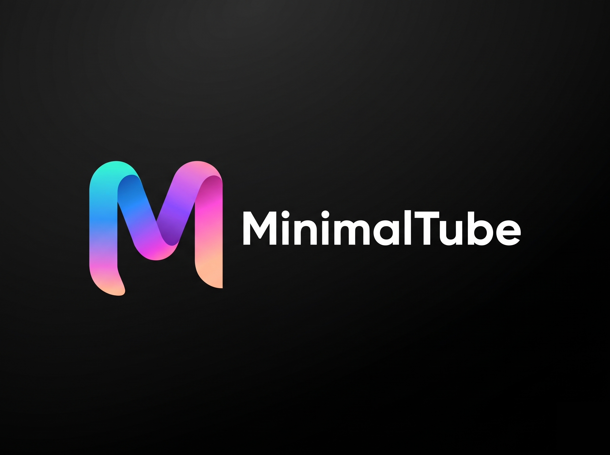

# MinimalTube

<p align="center">
  
</p>

<p align="center">
  <strong>A modern, distraction-free YouTube client for Android engineered with luxury minimalist dark mode and zero ads.</strong>
</p>

<p align="center">
  <a href="https://github.com/merrthereboy/MinimalTube/releases/latest">
    
  </a>
  <a href="https://github.com/merrthereboy/MinimalTube/actions/workflows/build-apk.yml">
    
  </a>
  
  
  
</p>

---

## Overview

**MinimalTube** is an open-source, privacy-focused Android application crafted for users who demand a clean, elegant, and ad-free YouTube experience. Instead of noisy algorithms, cluttering popups, and intrusive banners, MinimalTube features a tailored **Luxury Dark Mode** interface adhering strictly to an 80/15/5 visual hierarchy:
- **80% Canvas:** Deep Obsidian Dark Background (`#0D0D11`).
- **15% Surfaces & Typography:** Secondary card surfaces (`#18181F`) with pure white headers (`#FFFFFF`) and muted slate subtitles (`#A1A1AA`).
- **5% Brand Gradient Accents:** Smooth spectrum transition from `#00F2FE` (Cyan) &rarr; `#2472FC` (Blue) &rarr; `#7928CA` (Violet) &rarr; `#FF2E93` (Magenta) &rarr; `#FFBE98` (Peach) for active indicators and primary interactions.

The core extraction pipeline is powered by the latest [NewPipeExtractor](https://github.com/TeamNewPipe/NewPipeExtractor) (`v0.27.1`), ensuring direct stream parsing without dependency on proprietary Google Play Services.

---

## Key Features

- **100% Ad-Free Playback:** Stream videos directly without pre-roll ads, mid-rolls, or sponsored banners.
- **5-Tab Navigation:**
  1. **TRANG CHỦ (Home):** Filtered topics (All, Live, Music, Gaming, News, Tech, Trending) with responsive video cards.
  2. **SHORTS:** Clean portrait feed for YouTube Shorts.
  3. **FANS ZONE (Subscriptions):** Channel updates synced directly with your YouTube account.
  4. **VIDEO CỦA TÔI (Library):** Local watch history, liked videos, and playlists.
  5. **TÔI (Account & Profile):** Google account integration, session status, and configuration.
- **Google / YouTube Account Synchronization:**
  - Securely sign in to your Google Account via the built-in browser engine.
  - Sync subscribed channels, feed updates, and watch history directly to your device.
  - Zero external servers: Authentication cookies remain strictly on your local device.
- **Hardware-Accelerated ExoPlayer:** Low-latency playback with dynamic HLS adaptation and progressive MP4 fallback.
- **Persistent Signing Keystore:** Builds are signed with a unified keystore, allowing you to update the app directly over existing versions without uninstallation or signature mismatch errors.
- **Minimalist Vector Design:** Clean line art vectors with rounded cards (16dp). Zero cartoon emojis.

---

## Download & Releases

Download the official pre-compiled APK binary directly from GitHub:

👉 **[Download MinimalTube v1.1.0 APK](https://github.com/merrthereboy/MinimalTube/releases/latest)**

### Quick Installation:
1. Download `MinimalTube-v1.1.0.apk` onto your Android phone (Android 7.0 / API 24 or newer).
2. Tap the APK to install. If prompted, enable **"Install unknown apps"** in your settings.
3. Open MinimalTube and enjoy clean, instant video playback!

---

## Tech Stack

- **Platform:** Android SDK 34 (Android 7.0+ compatibility)
- **Language:** Kotlin 1.9 / JVM 17
- **Media Engine:** AndroidX Media3 ExoPlayer (`1.2.1`) with HLS & DASH extensions
- **Stream Parser:** [NewPipeExtractor](https://github.com/TeamNewPipe/NewPipeExtractor) `v0.27.1`
- **Networking:** Square OkHttp `4.12.0`
- **Image Caching:** Coil `2.5.0`
- **CI/CD:** Automated GitHub Actions build pipeline

---

## Building from Source

```bash
# Clone the repository
git clone https://github.com/merrthereboy/MinimalTube.git
cd MinimalTube

# Compile Release APK
./gradlew assembleRelease
```
The output APK will be generated at:
`app/build/outputs/apk/release/app-release.apk`

---

## Author & Credits

Developed with ❤️ by **Đoàn Tiến Đạt** ([@merrthereboy](https://github.com/merrthereboy)).
Built on the open-source foundation of the NewPipe project.
